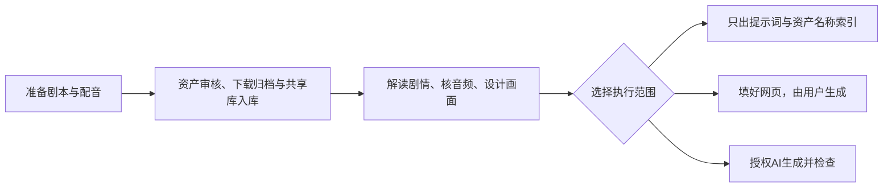

# Seedance Codex Workflow

**准备剧本、配音和资产表，让 Codex 完成资产整理、导演设计、提示词与授权范围内的网页制作。**

> 本地开发目录现为 **Core2.0.0候选**，仅本地验证；下面GitHub部署仍指正式1.9.6。测试本地候选请用本目录的[制作启动词](NEW_PROJECT_CONVERSATION_PROMPT.md)。

正式推荐：**Core 1.9.6**。日常只用两份启动词，填写顶部任务信息，其余内容整段保留。



| 你要做什么 | 打开这里 |
|---|---|
| 第一次用，跟着操作 | [大白话上手SOP](https://github.com/zengyies-ux/AIGC_Vedio_codex/blob/core-v1.9.6/QUICK_START.md) |
| 开新剧，先准备资产 | [资产下载审核启动词](https://github.com/zengyies-ux/AIGC_Vedio_codex/blob/core-v1.9.6/ASSET_DOWNLOAD_PROMPT.txt) |
| 制作一集或明确连续2—3集 | [视频制作启动词](https://github.com/zengyies-ux/AIGC_Vedio_codex/blob/core-v1.9.6/NEW_PROJECT_CONVERSATION_PROMPT.md) |
| 下载、升级 | [Core1.9.6正式Release](https://github.com/zengyies-ux/AIGC_Vedio_codex/releases/tag/core-v1.9.6) |

## ① 把部署交给Codex

首次安装或需要升级时，复制发送：

```text
请从 https://github.com/zengyies-ux/AIGC_Vedio_codex 部署正式推荐版 Core1.9.6。
读取 core-v1.9.6 标签下的 DEPLOYMENT.md，获取并校验正式核心包，自动准备本机环境并自检。
保留我已有的项目、素材、偏好和缓存。完成后告诉我核心、音频、浏览器是否可用，以及应在Codex中打开哪个含AGENTS.md的制作目录。
```

按提示登录账号或处理必要弹窗。安装和工具配置由Codex处理。

## ② 准备材料，先运行资产启动词

在电脑上建一个剧目文件夹，例如 `D:\短剧项目\项目01-黑手党`，放入：

- **完整英文剧本**，并说明本次负责哪些集。
- **每集一份完整MP3**：剪掉多余气口和长空白，保留旁白、对白、原顺序及必要停顿；有效WAV也可。
- 已有图片可一起放入，另准备能访问的**飞书在线资产表URL**。

在工作流项目中新开聊天，复制[资产下载审核启动词](https://github.com/zengyies-ux/AIGC_Vedio_codex/blob/core-v1.9.6/ASSET_DOWNLOAD_PROMPT.txt)，填写材料路径、负责集数和资产表。

提供该剧目的聚梦项目URL后，可将已核图片按角色、场景、道具放进共享素材库。**URL带哪一集都可作为该剧目的共享库入口，同图不逐集重复上传。**没提供制作网站URL时，先完成本地归档。

这一步不需要配音分析，不填分镜、不生成视频。已有资产完整且记录清楚时直接复用，不必重下全库。

## ③ 新开制作聊天，选好执行范围

资产准备完成、必要缺项补齐后，在同一工作流项目中新开聊天，复制[视频制作启动词](https://github.com/zengyies-ux/AIGC_Vedio_codex/blob/core-v1.9.6/NEW_PROJECT_CONVERSATION_PROMPT.md)，只修改“本次任务信息”。

- **只出提示词**：交完整分集分段正文和真实资产名称／路径索引，不操作聚梦制作网页。
- **只填稿，由用户点击生成**：填好正文与图片引用，由你检查并点击生成。
- **由AI生成**：按启动词中的明确授权提交、等待和检查，并在允许范围内修正关键问题。

需要填稿或生成时，**每一集都填自己的完整制作URL**；只出提示词可留空。想法可留空，也可直接说希望怎样表现。

制作会复用资产准备结果，C仍仔细核拟用图片和场景空间是否支持当前站位；只有缺项、冲突或来源变化时才回查在线材料。无需手填时码、逐镜表或内部配置。

中途确有问题时按提示补充。返修直接说“哪集、哪段、哪里不对、希望怎样改”。恢复时先说明当前执行范围，沿原记录继续，不重复提交。

<details>
<summary><strong>支持与验证范围</strong></summary>

用户已验证1.9.6并反馈效果可用，授权发布。运镜表现、长场面设计及新增／重复发声仍有改进反馈，发布不代表每集观感一致或问题全部解决。

Apple Silicon Mac已有多集、原生与一次延长、实际上传和审片副本清理记录。Windows x64提供CPU音频部署与自检；用户旧版实操可用，新版新增流程仍需真机验证。原始音轨本机定位，生成成片声音默认不听检。

不自动生成资产图、充值或无限返抽。只有明确授权才提交付费生成；未知回执先核，不能重复点击。当前支持活动任务内等待与中断后恢复，不承诺关闭应用后持续工作。

详细依据见[验证记录](https://github.com/zengyies-ux/AIGC_Vedio_codex/blob/core-v1.9.6/validation/director_v38.md)。

</details>

<details>
<summary><strong>下载和维护入口</strong></summary>

使用正式Release中的 `Seedance_Codex_Workflow_Core_v1.9.6_2026-10-22_release.zip` 及同名SHA校验文件；GitHub自动生成的Source code ZIP不作为团队制作包。干净核心包不含真实项目、资产、音视频、模型缓存或账号资料。

[部署说明](https://github.com/zengyies-ux/AIGC_Vedio_codex/blob/core-v1.9.6/DEPLOYMENT.md) · [制作规则](https://github.com/zengyies-ux/AIGC_Vedio_codex/blob/core-v1.9.6/AGENTS.md) · [网页技能](https://github.com/zengyies-ux/AIGC_Vedio_codex/blob/core-v1.9.6/extensions/seedance-jumeng-operator/SKILL.md) · [版本记录](https://github.com/zengyies-ux/AIGC_Vedio_codex/blob/core-v1.9.6/CHANGELOG.md) · [历史Release](https://github.com/zengyies-ux/AIGC_Vedio_codex/releases)

</details>
